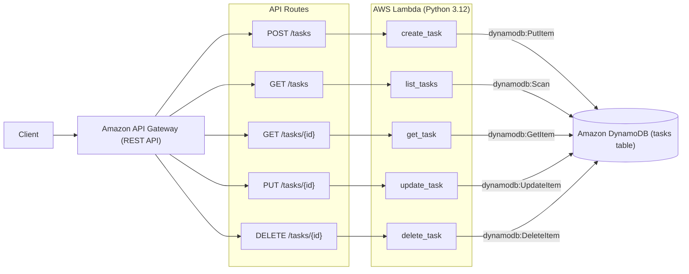

# AWS CDK Task Tracker API

[](https://github.com/lino2204/aws-cdk-task-tracker-api/actions/workflows/ci.yml)

A serverless CRUD API for managing tasks, built with **AWS CDK (Python)**.
Demonstrates infrastructure-as-code best practices: reusable CDK constructs,
least-privilege IAM, automated infrastructure & handler testing, and linting.

## Architecture



**Stack:**
- **Amazon API Gateway** — REST API entry point
- **AWS Lambda** — one function per CRUD operation (Python 3.12)
- **Amazon DynamoDB** — single-table storage for tasks
- **AWS CDK (Python)** — infrastructure defined as code, deployed via CloudFormation

## Why this project

This repo is a hands-on demonstration of:
- Writing **reusable CDK constructs** (not one flat stack) — see
  [`infra/constructs/api_lambda_dynamo_construct.py`](infra/constructs/api_lambda_dynamo_construct.py)
- **Least-privilege IAM** — each Lambda gets only the DynamoDB actions it needs
  (e.g. the `delete_task` function is scoped to `dynamodb:DeleteItem` only, and `get_task` can read but not write or delete)
- **Automated unit testing** with `pytest`, `aws_cdk.assertions` (synthesized CloudFormation template checks), and `moto` (in-memory DynamoDB handler tests)
- Clean, linted Python (`flake8`) enforced in CI via GitHub Actions across both infra and Lambda code

## Project structure

```
.
├── .github/
│   ├── CODEOWNERS                  # Automatic PR review assignment
│   └── workflows/
│       └── ci.yml                  # GitHub Actions CI (flake8, pytest, cdk synth)
├── app.py                          # CDK app entrypoint
├── Dockerfile                      # Local reproducible dev container
├── infra/
│   ├── task_api_stack.py           # Top-level stack, wires constructs together
│   └── constructs/
│       └── api_lambda_dynamo_construct.py   # Reusable API+Lambda+DynamoDB construct
├── lambda/
│   ├── create_task/handler.py
│   ├── get_task/handler.py
│   ├── list_tasks/handler.py
│   ├── update_task/handler.py
│   └── delete_task/handler.py
└── tests/
    └── unit/
        ├── test_task_api_stack.py  # CDK CloudFormation template assertions
        └── test_lambda_handlers.py # Lambda CRUD handler unit tests (moto)
```

## API endpoints

| Method | Path              | Description          |
|--------|-------------------|-----------------------|
| POST   | `/tasks`           | Create a task         |
| GET    | `/tasks`           | List all tasks        |
| GET    | `/tasks/{id}`      | Get a single task     |
| PUT    | `/tasks/{id}`      | Update a task         |
| DELETE | `/tasks/{id}`      | Delete a task         |

### Task item shape
```json
{
  "task_id": "uuid",
  "title": "string",
  "status": "pending | done",
  "created_at": "ISO-8601 timestamp"
}
```

## Prerequisites

- Python 3.12+
- Node.js 18+ (required by the CDK CLI)
- AWS CLI configured with credentials (`aws configure`)
- AWS CDK CLI: `npm install -g aws-cdk`

## Setup

```bash
# Clone the repo
git clone https://github.com/lino2204/aws-cdk-task-tracker-api.git
cd aws-cdk-task-tracker-api

# Create and activate a virtual environment
python3 -m venv .venv
source .venv/bin/activate    # Windows: .venv\Scripts\activate

# Install dependencies
pip install -r requirements-dev.txt

# Bootstrap your AWS environment (only needed once per account/region)
cdk bootstrap
```

## Useful commands

| Command                | Purpose                                              |
|-------------------------|-------------------------------------------------------|
| `cdk synth`             | Synthesize the CloudFormation template               |
| `cdk diff`               | Compare deployed stack with local changes            |
| `cdk deploy`            | Deploy the stack to AWS                               |
| `cdk destroy`           | Tear down all deployed resources                      |
| `pytest`                | Run unit tests                                        |
| `pytest --cov`          | Run tests with coverage report                        |
| `flake8 .`               | Lint infra and Lambda code                            |

## Testing

Both infrastructure and Lambda handlers are tested entirely in memory (without
deploying to AWS) — making the test suite fast and safe to run in CI:

```bash
pytest tests/unit -v --cov=infra --cov=lambda
```

What's covered:
- **Infrastructure (`tests/unit/test_task_api_stack.py` via `aws_cdk.assertions`):**
  - DynamoDB table has the correct partition key (`task_id`) and billing mode (`PAY_PER_REQUEST`)
  - 5 Python 3.12 Lambda functions and 1 API Gateway REST API with expected HTTP methods
  - Least-privilege IAM policies (e.g. `delete_task` is scoped to `dynamodb:DeleteItem` only, and no IAM policy uses wildcard `dynamodb:*` actions)
- **Lambda Handlers (`tests/unit/test_lambda_handlers.py` via `moto`):**
  - Full CRUD lifecycle (`create_task`, `get_task`, `list_tasks`, `update_task`, `delete_task`) against an in-memory mocked DynamoDB table
  - Validation and error handling (`400 Bad Request` on invalid JSON / missing fields, `404 Not Found` on missing items and `ConditionalCheckFailedException`)

## Deployment

```bash
cdk deploy
```

After deployment, the API Gateway invoke URL will be printed as a stack output.

To remove all resources:
```bash
cdk destroy
```

## Design notes

- **One construct, reused** — `ApiLambdaDynamoConstruct` takes the DynamoDB
  table config and a dict of route → Lambda handler mappings as props, so it
  isn't hardcoded to this specific task-tracker API and could be reused for a
  different resource with different routes.
- **Least privilege IAM** — rather than granting each Lambda broad
  `dynamodb:*` access, each function is granted only the specific actions it
  performs (e.g. `create_task` gets `PutItem`, not `DeleteItem`).
- **Removal policy** — the DynamoDB table uses `RemovalPolicy.DESTROY` for
  easy teardown in this demo project; in production this would typically be
  `RETAIN`.

## License

MIT
